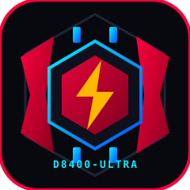

  

<h1 align="center">🔴 RedDimensity 8400-Ultra Game Space (MT6899 Edition)</h1>

  
  
  
  

**RedDimensity Space** adalah aplikasi *Game Booster, Hardware Telemetry & In-Game Overlay Controller* bergaya **Nubia Red Magic Energy Cube & Gravity X** yang dirancang khusus untuk arsitektur **MediaTek Dimensity 8400-Ultra (MT6899 - 4nm TSMC)** seperti pada **POCO X7 Pro, Redmi Turbo 4, dan Xiaomi 15T**.

## ⚡ Fitur Lengkap
- **🔥 Diablo Mode (Mode Dewa):** Mengunci seluruh 8 *All-Big-Core Cortex-A725* di frekuensi puncak **3.25 GHz** dan **GPU Mali-G720 MC7 di 1300 MHz (OPP 0)**.
- **🎯 Custom Crosshair Aim Assist:** 4 Desain + 4 Warna Neon + Pengatur Ukuran (*Touch-Passthrough*).
- **📊 Floating In-Game FPS & Clock HUD:** FPS *real-time* (`Choreographer` API) & suhu baterai.
- **🎧 Scout Mode (Hardware Audio DSP Equalizer):** Mengangkat frekuensi **2kHz - 4kHz** untuk memperjelas suara langkah kaki (*footstep*) musuh.
- **🔌 Charge Separation (Bypass Charging):** Mengalirkan daya langsung ke *motherboard* (Root/Supported Kernel).
- **🚀 MediaTek HyperEngine & Game Space Launcher:** Toggle *MFRC 120/144Hz*, *Mali-G720 Ray Tracing Boost*, *2160Hz Instant Touch Sampling*, *NOS 5G/Wi-Fi Low-Latency*, serta *LPDDR5X RAM Cleaner*.
